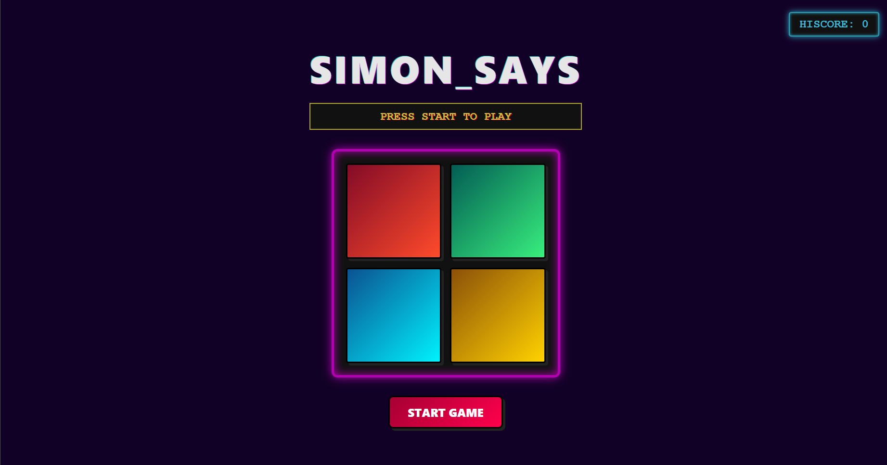

# 🕹️ SIMON SAYS ARCADE

An 80s Retro Synthwave / CRT Arcade edition of the classic Simon Says memory game built with vanilla JavaScript, HTML5, and CSS3.




🎮 **Play Live Demo:** [https://chanakya-9.github.io/Simion_Says/](https://chanakya-9.github.io/Simion_Says/)

---

## 🎯 How to Play

1. Click **START GAME** to begin.
2. Watch closely as the arcade buttons flash in sequence.
3. Repeat the sequence by clicking the colored arcade buttons in the exact same order.
4. Each round adds one more color to the sequence.
5. Hit the wrong button and it's **GAME OVER**! Beat your high score!

---

## ✨ Features

- **🎮 80s Arcade & Synthwave Aesthetic**: Deep purple neon glow, CRT styling, and arcade-style typography.
- **⚡ Tactile Feedback**: Chunky 3D button press animations and neon border flashes.
- **🏆 Live High Score**: Tracks your highest streak during your session.
- **🛡️ Player Turn Guard**: Prevents accidental clicks while the computer is playing its sequence.
- **📱 Responsive Layout**: Centered arcade cabinet display that looks great across screen sizes.

---

## 🛠️ Built With

- **HTML5** – Semantic structure & arcade board layout
- **CSS3** – Retro gradients, neon shadows, and CSS Grid
- **JavaScript (ES6+)** – Game state engine, random sequence generation, and timing control

## 🌐 Live Demo

You can play the live version directly in your browser:  
👉 **[Launch Simon Says Arcade](https://chanakya-9.github.io/Simion_Says/)**

---

## 🚀 Quick Start

No dependencies or build steps required! Simply open the project in your browser:

1. Clone or download the repository:
   ```bash
   git clone https://github.com/Chanakya-9/Simion_Says.git
   ```
2. Double-click [index.html](file:///c:/Users/chana/Desktop/new%20Web%20dev/simon_says/index.html) to play!

---

## 👤 Author

**Chanakya Navghare**  
[GitHub Profile](https://github.com/Chanakya-9)
